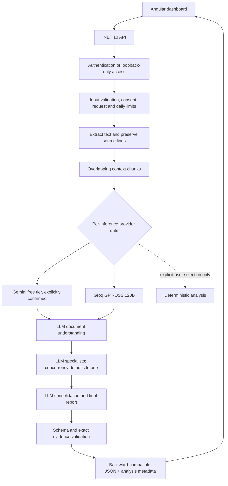

# AI Document Intelligence Architecture

The .NET API parses documents, preserves source lines, routes each inference through the ordered provider chain, validates the report, and checks each evidence quotation against the source. A failed stage can move to the next eligible provider without replaying completed specialist work. The response records every provider/model used. Provider failure never silently falls back to deterministic rules.

Free-only mode is enabled by default. Gemini is eligible only after an operator confirms the Google project is on the free tier and billing is disabled; the application cannot verify billing status. Groq's configured `openai/gpt-oss-120b` model is priced and is blocked while free-only mode is enabled. Cloud inference requires one-time explicit consent, persisted encrypted on the backend and bound to the account (or local browser profile), policy version, and analysis/presentation scope.

Normal users see read-only AI service health and do not enter credentials or an administrator token. Provider keys are loaded from backend environment variables or .NET configuration/User Secrets and are never exposed to Angular. Protected administrator endpoints use the `Admin` role when Azure AD is configured; otherwise they require a strong backend `AI_ADMIN_TOKEN`, HTTPS for non-loopback connections, and rate limiting. Optional saved credentials are protected at rest with ASP.NET Core Data Protection. ASP.NET Core does not load dotenv files by default; `.env.example` is documentation only.

The router skips disabled or unconfigured providers, respects priority, applies bounded retries and rate-limit cooldowns, enforces an overall request deadline and inference-call budget, and tracks provider health with an in-memory circuit breaker. Gemini is the default analysis provider; presentation planning resolves the legacy `Analysis:Provider=Configured` value to the first provider in `AI_PROVIDER_ORDER` and uses the same inference fallback router. Optional free-tier analysis combines compatible specialist tasks per chunk while preserving source evidence checks; detailed specialist analysis remains available. On startup, configured providers receive a bounded metadata-only connection check. `GET /api/ai/status` reports safe configuration and health metadata without returning credentials. Results are short-lived, in-memory cached per authenticated identity or loopback client. Request limits and cache state are process-local; use shared distributed controls before horizontal deployment.

When Azure AD is configured, analysis and presentation-preview routes require authentication. Without Azure AD, those routes only accept loopback requests. The backend validates persisted consent before analysis or presentation source processing; client-supplied booleans are not authorization. Consent can be reviewed or withdrawn in Workspace settings. Requests are capped by input size, per-minute rate, daily analysis quota, and inference-call budget. Provider errors returned to clients are categorized and sanitized; credentials, document text, and raw provider error bodies are not included.

Programmatic code validates report shape and rejects quotations that cannot be found in the cited source. Evidence validation establishes quotation traceability only; it is not human verification or confirmation of real-world exploitability. Provider setup and limitations are in [README.md](README.md).
