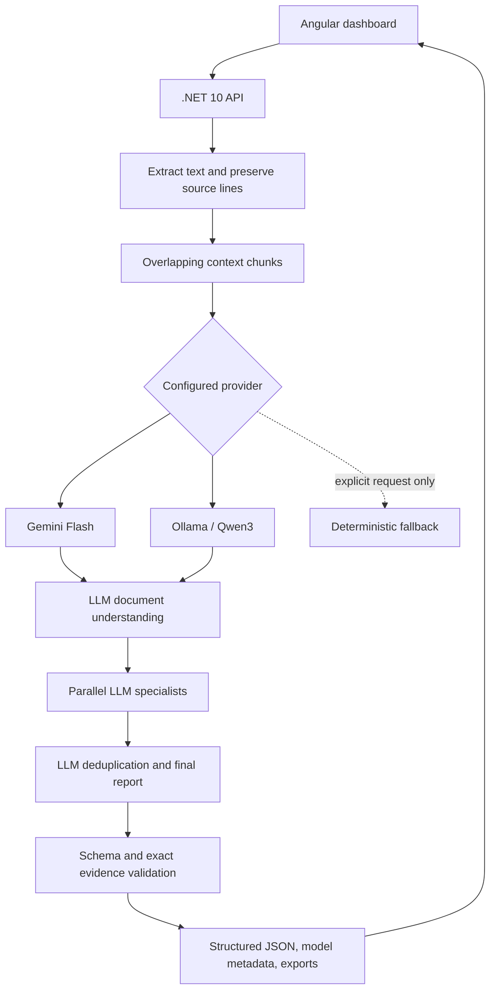

# AI Document Intelligence Architecture

The configured LLM is the primary analysis engine. The old deterministic `AgentServices` implementation is used only when a caller explicitly selects the rules-based fallback.

Each successful AI review invokes the model for document understanding, five specialist tasks (security, architecture, compliance, business impact, and recommendations), and final consolidation. Long documents use per-chunk understanding and specialist calls, with bounded parallelism and a final document-level synthesis.

Programmatic code extracts supported formats, preserves source line references, validates required report fields and severity values, and rejects quotations that cannot be found in the cited source. Evidence validation establishes quotation traceability only; it is not human verification or confirmation of real-world exploitability.

Provider errors are returned explicitly as HTTP 503; there is no automatic switch to deterministic analysis. Provider, model, timing, call count, and available token usage are returned in `modelInfo`. Setup and API examples are in [README.md](README.md).
