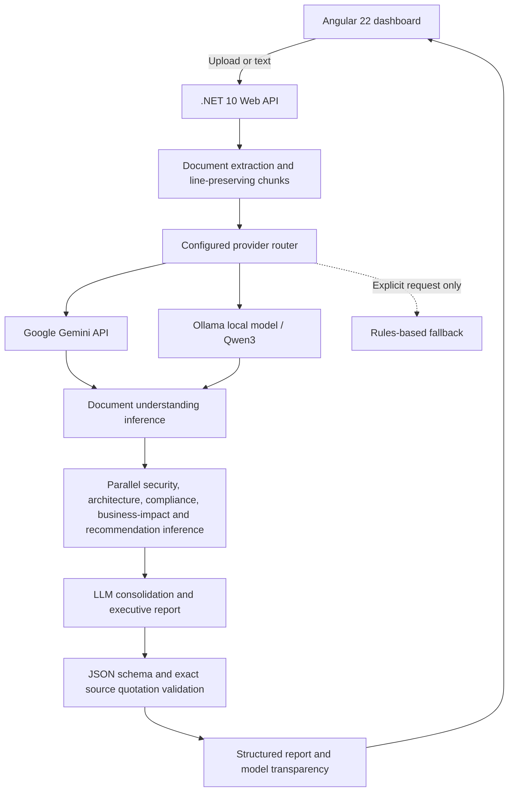

# AI Document Digest

An evidence-backed document intelligence platform. The .NET 10 API uses a configured LLM as the primary analysis engine; deterministic rules are available only when explicitly selected as a fallback. Document parsing, line mapping, output schema validation, and source-evidence checks remain programmatic.

## Architecture



The AI provider performs document understanding, each specialist analysis, consolidation, and report generation. Findings are model-generated; evidence quotations and line ranges are checked against extracted source lines before the API returns a successful response. This checks traceability, not whether a real system is exploitable or whether a human has verified the finding.

## Supported documents

Markdown, plain text, HTML, JSON, and XML. The current API does not parse PDF. Large documents are split into overlapping source-line chunks, analyzed by the configured model, and consolidated. The default maximum is 40 chunks; it can be adjusted with `Analysis__MaxChunks`. Oversized documents fail explicitly rather than being silently truncated.

## Configure a provider

Provider selection is controlled by backend configuration. The default is Gemini; there is no deterministic fallback if the selected provider is unavailable.

### Google Gemini

Create a key in [Google AI Studio](https://aistudio.google.com/api-keys). Set it in the API process environment; do not put it in Angular settings or commit it to source control:

```powershell
$env:Analysis__Provider = "Gemini"
$env:Gemini__Model = "gemini-2.5-flash"
$env:Gemini__ApiKey = "your-Google-AI-Studio-key"
Set-Location "Backend\AI.Digest.Api"
dotnet run --urls http://localhost:5050
```

Change `Gemini__Model` to any model ID enabled for your Google AI Studio account. Gemini API quotas and free-tier terms may change. Cloud analysis sends document content to Google; do not upload sensitive material unless your organization's provider terms permit it.

### Ollama / Qwen3

Install Ollama, then pull a model supported by your machine. For example:

```powershell
ollama pull qwen3:8b
$env:Analysis__Provider = "Ollama"
$env:Ollama__BaseUrl = "http://localhost:11434"
$env:Ollama__Model = "qwen3:8b"
Set-Location "Backend\AI.Digest.Api"
dotnet run --urls http://localhost:5050
```

The configured Ollama model is invoked through its `/api/chat` JSON endpoint. No cloud API key is required for local inference.

### Analysis configuration

Configuration can be supplied in `appsettings.json` or with .NET environment-variable overrides:

| Setting | Default | Purpose |
|---|---|---|
| `Analysis__Provider` | `Gemini` | `Gemini` or `Ollama` |
| `Analysis__ChunkCharacters` | `12000` | Approximate maximum chunk text size |
| `Analysis__ChunkOverlapLines` | `5` | Source lines repeated between adjacent chunks |
| `Analysis__MaxChunks` | `40` | Explicit safety limit; larger requests fail |
| `Analysis__MaxParallelCalls` | `4` | Bounded concurrent specialist model requests |
| `Analysis__MaxConsolidationFindings` | `250` | Candidate limit passed to final consolidation |
| `Gemini__Model` | `gemini-2.5-flash` | Gemini model ID |
| `Ollama__BaseUrl` | `http://localhost:11434` | Local Ollama URL |
| `Ollama__Model` | `qwen3:8b` | Local model tag |

## Run the application

Start the API from `Backend\AI.Digest.Api`:

```powershell
dotnet run --urls http://localhost:5050
```

Start Angular from `Frontend\AI.Digest.Web`:

```powershell
npm install
npm start
```

Open `http://localhost:4200`. The analysis screen defaults to the API-configured AI provider. A separate **Rules-based fallback** option is available and must be explicitly selected; its output is labeled as deterministic and is not LLM analysis. If AI analysis fails, the API returns HTTP 503 with `AI analysis unavailable – provider error.` and the UI allows retry.

## API testing

### Text analysis

```powershell
$body = @{
    title = "sample-architecture.md"
    text = Get-Content "docs\sample-architecture.md" -Raw
    useCase = "Review security, architecture, compliance evidence, and business impact."
} | ConvertTo-Json

Invoke-RestMethod `
    -Method Post `
    -Uri "http://localhost:5050/api/documents/analyse-text" `
    -ContentType "application/json" `
    -Body $body | ConvertTo-Json -Depth 20
```

### Multipart upload

```powershell
curl.exe -F "file=@docs/sample-architecture.md" `
    -F "useCase=Review operational and security risks" `
    http://localhost:5050/api/documents/analyse
```

### Verify real provider connectivity

With Gemini credentials or a running Ollama model configured, call:

```powershell
powershell -ExecutionPolicy Bypass -File "scripts\Test-AiProvider.ps1"
```

The script fails unless the response includes provider metadata and at least one actual model inference call. Live connectivity tests are kept separate from deterministic automated tests because they require provider credentials or a local model and network/model availability.

### Explicit rules fallback

To deliberately run the legacy rules-based mode, send `analysisMode: "Deterministic"` in the JSON text request, or submit `analysisMode=Deterministic` as a multipart form field. Do not select this mode when an AI-generated review is required.

## Tests

Run the mock-model pipeline tests:

```powershell
$testOutput = Join-Path $env:TEMP "AI-Digest-TestOutput"
dotnet test "Backend\AI.Digest.Api.Tests\AI.Digest.Api.Tests.csproj" "-p:OutDir=$testOutput\"
```

The integration tests use a mock `IAiModelClient` to verify that the document-understanding stage, five specialist tasks, and consolidation are actually called; they also reject unsupported quotations. Optional live Gemini/Ollama connectivity test methods are skipped by the default suite. Use the connectivity script above for a configured real provider.

## Report fields

Successful AI responses include:

- `aiReport`: document understanding, security/architecture/compliance assessments, business impact, detailed findings, priority actions, and overall assessment.
- `modelInfo`: provider/model/version, start and completion times, inference-call count, token usage when returned by the provider, status, and a statement that findings are AI-generated while evidence is programmatically checked.
- Legacy finding arrays and export fields for compatibility with the existing UI/history formats.

Findings can use `CRITICAL`, `HIGH`, `MEDIUM`, `LOW`, or `INFORMATIONAL`. A zero-finding report is valid. Every reported finding must include a source quotation with a supported line range. Invalid JSON, provider failures, and invented/unsupported citations fail the request rather than silently falling back.
