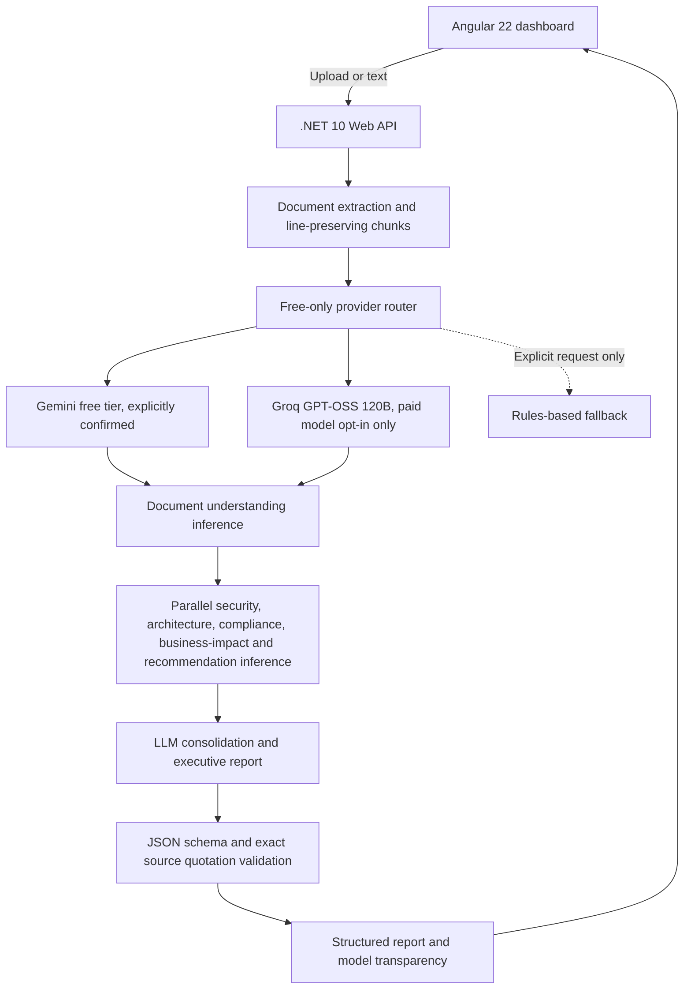

# AI Document Digest

An evidence-backed document intelligence platform. The .NET 10 API runs a prioritized AI provider chain, validates model output and source evidence, and keeps rules-based analysis as an explicitly selected mode.

## Architecture



The same selected provider performs document understanding, specialist analysis, consolidation, and report generation. Failures cause a bounded retry and then failover to the next eligible provider; results are not silently mixed across providers. Findings are model-generated; evidence quotations and line ranges are checked against extracted source lines before a successful response. This checks traceability, not whether a real system is exploitable or whether a human has verified the finding.

## Supported documents

Markdown, plain text, HTML, JSON, and XML. PDF parsing is not currently supported. The default maximum is 40 analysis chunks and 500,000 input characters; oversized documents fail instead of being silently truncated.

## AI providers, safety, and configuration

Provider credentials are resolved from `GEMINI_API_KEY` / `GROQ_API_KEY`, `.NET` configuration sections (`Gemini:ApiKey` / `Groq:ApiKey`), .NET User Secrets, and the equivalent environment naming (`Gemini__ApiKey` / `Groq__ApiKey`). Empty and placeholder values are ignored. The local checkout currently has no provider key in environment variables, .NET User Secrets, appsettings, or the encrypted admin store, so live local inference remains unconfigured. No real `.env` file exists: ASP.NET Core does not load dotenv files automatically.

The API project now has a User Secrets ID. In Development, ASP.NET Core loads secrets such as `Gemini:ApiKey` automatically; ensure `ASPNETCORE_ENVIRONMENT=Development` is set when running locally. Production should use environment variables or a deployment secret manager. Deployment environment variables override appsettings, and standard configuration ordering is preserved. Never put real keys in appsettings, frontend code, or Git.

Normal users do not need an administrator token or provider keys in the frontend. The dashboard displays read-only service status. Configure keys in the backend process environment, deployment secret manager, or .NET User Secrets; credentials are never sent to or stored by the Angular application. The optional protected admin API can still manage encrypted settings. With Azure AD configured, it requires the `Admin` role; otherwise it requires a strong backend `AI_ADMIN_TOKEN` and HTTPS for non-loopback connections. Set `AI_SETTINGS_PATH` and `AI_DATA_PROTECTION_KEYS_PATH` when deployment storage needs a different persistent location.

The configured order is Gemini first, Groq second. Free-only mode is enabled by default. Gemini is eligible only after explicitly confirming that the key belongs to a free-tier Google AI Studio project with billing disabled. The application cannot inspect account billing. Groq's requested `openai/gpt-oss-120b` model is priced, so it is blocked while free-only mode is on; it is not an eligible no-charge fallback. Do not disable free-only unless paid use is explicitly approved. No live provider connection is claimed without valid credentials.

Set credentials for local Development with .NET User Secrets (from `Backend\AI.Digest.Api`):

```powershell
dotnet user-secrets set "Gemini:ApiKey" "<your Gemini key>"
dotnet user-secrets set "GEMINI_FREE_TIER_CONFIRMED" "true"
```

The free-tier confirmation is a server-side safeguard; set it only after confirming that billing is disabled on the Google project. Use `GROQ_API_KEY` or `Groq:ApiKey` only if the configured model is eligible under the free-only policy. `.env.example` documents variable names but is not automatically loaded.

Use the direct key pages: [Google AI Studio](https://aistudio.google.com/apikey) and [Groq Console](https://console.groq.com/keys). Only set the Gemini free-tier confirmation after verifying that billing is disabled on the Google project. Cloud analysis requires explicit one-time consent, stored encrypted on the backend and scoped to the user's account, policy version, and document-analysis/presentation use. Users can review or withdraw consent in Workspace settings. Without Azure AD, a persistent local browser-profile cookie scopes consent and analysis endpoints accept loopback requests only.

`AI_PROVIDER_ORDER`, `GEMINI_ENABLED`, `GEMINI_MODEL`, `GROQ_ENABLED`, and `GROQ_MODEL` configure the provider chain. `AI_ENABLED`, `AI_FREE_ONLY`, and `AI_FALLBACK_ENABLED` control its behavior. Other controls include `AI_PROVIDER_TIMEOUT_SECONDS`, `AI_REQUEST_TIMEOUT_SECONDS`, `AI_RETRY_LIMIT`, `AI_MAX_INFERENCE_CALLS_PER_REQUEST`, `AI_DAILY_USAGE_LIMIT`, and `AI_FREE_TIER_ANALYSIS_MODE`. Detailed specialist analysis remains the default; optional free-tier mode combines compatible roles per document chunk while retaining evidence validation. Provider fallback occurs per inference, so completed specialist work is not repeated. Inference concurrency defaults to one. Environment model overrides must match the two supported IDs or that provider is disabled. The in-memory analysis cache is user-scoped and is not persisted to disk.

At startup, configured providers receive a bounded metadata-only connection check; no inference is generated. `GET /api/ai/status` reports Online/Offline, active provider/model, fallback status, and the latest successful provider request without returning credentials. A metadata-only **Test connection** action is shown only to authenticated administrators. The protected **Test inference** API is not exposed in the normal user workflow and can consume provider quota.

The API keeps the existing digest fields and adds the standardized `success`, `provider`, `model`, `analysis`, `summary`, `warnings`, `processingTime`, and `error` fields. Failed provider responses never include raw provider bodies or credentials. Analysis requests are limited to five per minute and ten uncached analyses per user/IP per UTC day by default.

## Presentation Studio

The Presentation Studio accepts Markdown/TXT uploads, public GitHub repository URLs, authorized remote application URLs, and use-case descriptions. Select a source in the Angular UI, configure title/audience/purpose/slide count/aspect ratio/options, and generate an editable PPTX, PDF, and interactive standalone HTML.

The interactive preview and standalone HTML export render Mermaid flowchart edges as an SVG graph, preserving supported node connections, decision diamonds, direction and labeled branches without a CDN. Source-backed bar, line and donut/pie chart data is rendered as SVG as well. If a diagram uses unsupported Mermaid syntax, its source is shown as a fallback rather than being misrepresented as a sequential workflow. Diagrams remain source-derived; generated architecture must not be interpreted as verified infrastructure unless the source supports it.

The portal and standalone HTML viewer share the Prism Blue design tokens in `Frontend/AI.Digest.Web/src/prism-blue.css`. Prism Blue is the default presentation theme; the offline viewer embeds these tokens and its rendering code without a CDN. It includes a navy/cyan control bar, responsive slide canvases, source-backed charts, safe SVG diagrams and tables, keyboard navigation, optional progressive reveal, overview, notes, timer, and scroll mode. Unicode content is exported as UTF-8 with a language tag and Tamil-friendly system font fallbacks.

The presentation workspace accepts user storytelling/design instructions, language, visual intensity, and configurable diagram/chart/recommendation options. Its editor provides live title, subtitle, content, notes, layout, font, color, size, spacing, alignment, image, chart-data, table-data, Mermaid, and visual-card/icon editing. Tables are validated for bounded dimensions and rendered in both the editor and offline HTML export. Slides can be inserted, duplicated, deleted, drag-reordered, and multi-selected. The preview has zoom and alignment guides. Manual changes auto-save to the API session, can be undone/redone, and are tracked in presentation versions with compare and restore actions. AI edits are proposals: choose an element, one slide, selected slides, or the whole deck, describe the requested change, then accept or reject the result. The editor sends only the selected slides to the AI editing endpoint; the API validates slide identities and merges only the selected scope. Cloud AI consent and configured provider availability are required.

Presentation API endpoints:

| Method | Endpoint | Purpose |
|---|---|---|
| POST | `/api/presentations/preview` | Generate or preview a presentation |
| POST | `/api/presentations/{id}/edit` | Request a scoped AI edit proposal |
| GET | `/api/presentations` | List API-session presentation history |
| GET | `/api/presentations/{id}` | Retrieve a presentation |
| PUT | `/api/presentations/{id}` | Save preview edits |
| GET | `/api/presentations/{id}/versions` | List saved presentation versions |
| GET | `/api/presentations/{id}/versions/{versionId}` | Retrieve a version for comparison |
| POST | `/api/presentations/{id}/versions/{versionId}/restore` | Restore a saved version |
| GET | `/api/presentations/{id}/pptx` | Download editable PPTX |
| GET | `/api/presentations/{id}/pdf` | Download PDF |
| GET | `/api/presentations/{id}/html` | Download standalone interactive HTML |
| DELETE | `/api/presentations/{id}` | Delete presentation |

GitHub access can use `GitHub__Token` for private repositories. Application URL inspection rejects loopback, private networks, cloud metadata ranges, and unvalidated schemes by default. Use a remote HTTPS application URL or explicitly authorized browser integration for local application inspection. The portal uses the shared Prism Blue navy, electric-blue, cyan and teal design tokens.

## Run the application

Start the API from `Backend\AI.Digest.Api`:

```powershell
dotnet run --urls http://localhost:5050
```

Start Angular from `Frontend\AI.Digest.Web`:

```powershell
npm install
npm start
```

Open `http://localhost:4200`. The analysis screen defaults to the free-only provider chain. The first cloud analysis or presentation request opens a consent dialog; after consent is saved, subsequent requests reuse it until it is withdrawn or the policy scope changes. A **Rules-based fallback** option is available and must be explicitly selected; its output is not LLM analysis. Provider errors are converted to safe, actionable messages, and the UI allows retry.

## API testing

### Text analysis

Cloud requests require consent already granted through the application or for the authenticated account. The API validates the saved consent record; request fields alone do not grant it.

```powershell
$body = @{
    title = "sample-architecture.md"
    text = Get-Content "docs\sample-architecture.md" -Raw
    useCase = "Review security, architecture, compliance evidence, and business impact."
    cloudConsentScope = "gemini-and-groq-cloud-document-analysis-and-presentation"
    cloudConsentPolicyVersion = "1"
} | ConvertTo-Json

Invoke-RestMethod `
    -Method Post `
    -Uri "http://localhost:5050/api/documents/analyse-text" `
    -ContentType "application/json" `
    -Body $body | ConvertTo-Json -Depth 20
```

### Multipart upload

```powershell
curl.exe -F "file=@docs/sample-architecture.md" `
    -F "useCase=Review operational and security risks" `
    http://localhost:5050/api/documents/analyse
```

### Verify real provider connectivity

The administrator page's **Test connection** checks Gemini's model metadata endpoint or Groq's model list; it does not generate text or incur inference charges. Actual AI analysis still requires a valid provider key and an eligible model. The real-inference smoke test below should only be used with an intentionally configured provider:

```powershell
powershell -ExecutionPolicy Bypass -File "scripts\Test-AiProvider.ps1"
```

The script fails unless the response includes provider metadata and an actual model inference call. Live inference was not tested in this environment because both provider keys are missing. Groq's requested model is priced and is blocked while free-only mode is enabled; never disable free-only unless paid usage is explicitly approved.

### Explicit rules fallback

To deliberately run the legacy rules-based mode, send `analysisMode: "Deterministic"` in the JSON text request, or submit `analysisMode=Deterministic` as a multipart form field. Do not select this mode when an AI-generated review is required.

## Tests

Run the mock-model pipeline tests:

```powershell
$testOutput = Join-Path $env:TEMP "AI-Digest-TestOutput"
dotnet test "Backend\AI.Digest.Api.Tests\AI.Digest.Api.Tests.csproj" "-p:OutDir=$testOutput\"
```

The integration tests use a mock `IAiModelClient` to verify that the document-understanding stage, five specialist tasks, and consolidation are actually called; they also reject unsupported quotations. Optional live-provider connectivity tests are skipped by the default suite. Use the connectivity script above for a configured real provider.

## Report fields

Successful AI responses keep the existing digest fields and also expose:

- `success`, `provider`, `model`, `analysis`, `summary`, `keyFindings`, `recommendations`, `warnings`, `processingTime`, and `error` in a common response envelope.
- `aiReport`: document understanding, security/architecture/compliance assessments, business impact, detailed findings, priority actions, and overall assessment.
- `modelInfo`: provider/model/version, start and completion times, inference-call count, token usage when returned by the provider, status, and a statement that findings are AI-generated while evidence is programmatically checked.
- Legacy finding arrays and export fields for compatibility with the existing UI/history formats.

Findings can use `CRITICAL`, `HIGH`, `MEDIUM`, `LOW`, or `INFORMATIONAL`. A zero-finding report is valid. Every reported finding must include a source quotation with a supported line range. Invalid JSON, provider failures, and invented/unsupported citations fail the request rather than silently falling back.
